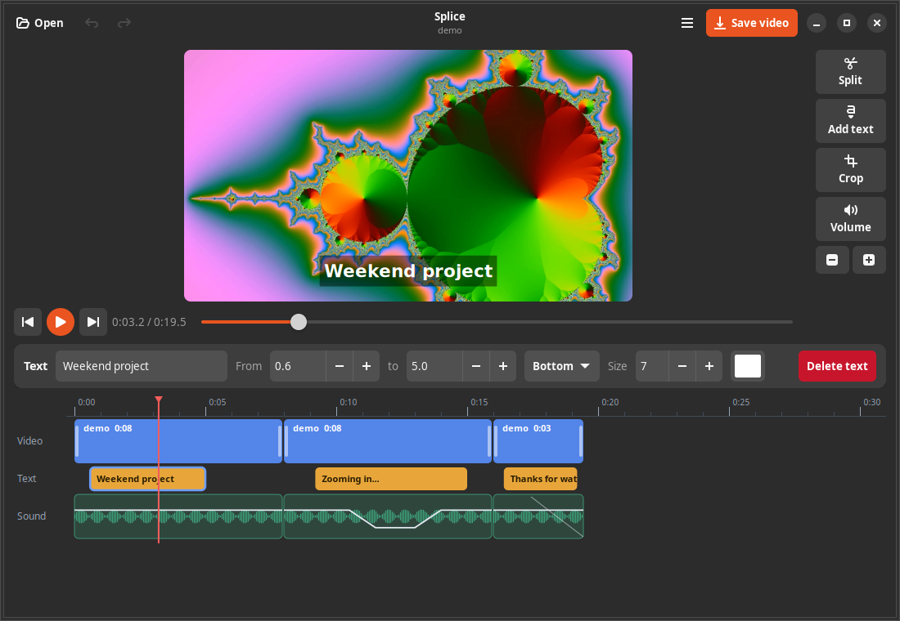
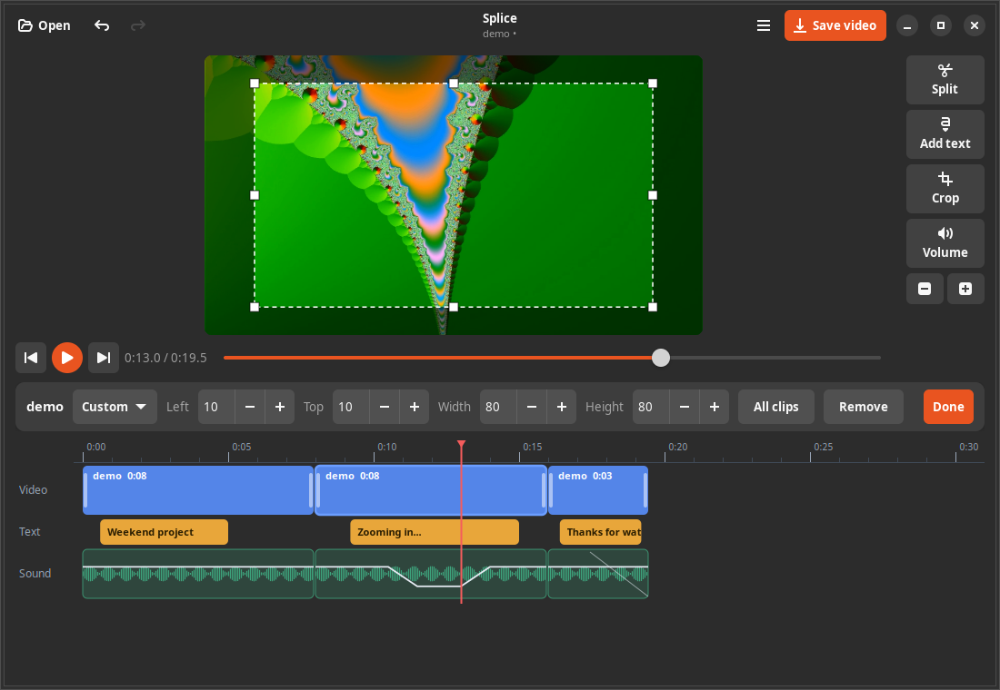

<p align="center"></p>

<h1 align="center">Splice</h1>
<p align="center"><b>Trim, join, caption, balance the sound, crop. Nothing else.</b><br>
A small video editor for the GNOME desktop on Ubuntu.</p>
<p align="center">
<a href="https://github.com/GAServantes/splice/actions/workflows/ci.yml"></a>
<a href="https://github.com/GAServantes/splice/releases/latest"></a>
<a href="LICENSE"></a>
</p>



Splice is for the quick jobs: cut the dead air out of a screen recording, put
a few clips in order, add a caption, turn one section down, crop to a shape,
save. It is a small program (under 3,000 lines of Python, no timeline engine
to learn), and it uses your GPU to save the result.

The timeline has three lanes. **Video** holds your clips, **Text** holds
captions, **Sound** shows each clip's waveform with a volume line you can
bend. Everything is edited by dragging on the lane itself.

## What it does

- **Trim.** Drag the edges of a clip, or type exact times. Split at the
  playhead with `S`.
- **Join.** Drag clips into any order. Captions travel with the clip they
  start in, and later clips and captions move up when you trim or delete.
- **Add text.** Click *Add text*, then drag the block to time it. Captions can
  sit at the top, middle or bottom, with any size and colour. Emoji, Japanese,
  Chinese, Korean, Arabic and accented text all draw correctly, and long
  captions shrink to fit.
- **Change sound.** Overall volume, fade in and out, and a volume line you
  drag in the Sound lane (click the line to add a point, right-click a point
  to remove it). Clips without sound just work.
- **Crop.** Drag the box right on the picture, by the middle or any of the
  eight handles. Pick a shape (16:9, 4:3, 1:1, 9:16) to keep that shape while
  you drag, or type numbers.
- **Preview that matches the result.** The preview shows the saved shape,
  crop and captions, in colour and in sync with the sound.
- **Save on your GPU.** Export uses the VAAPI H.264 encoder (tested on a
  Radeon; other VAAPI graphics should work) and falls back to the CPU on its own if the card can't take the
  video, so a save never fails because of the GPU. The "Saved" message says
  which one did the work.
- **Undo and redo** for every edit, **save your project** to a `.splice` file,
  and **drop videos** onto the window.
- **Safe saving.** Saving writes to a temporary file first, so a cancelled or
  failed export never damages an existing video. Splice refuses to save over
  one of your own clips.

<p align="center"></p>

Phone videos (rotated), portrait video, odd frame sizes, variable frame rate,
60 and 29.97 fps, 10-bit, 4K, mono and surround sound all work, and colours
come out as they went in.

## Install

Requirements: Ubuntu 24.04 on GNOME (what it is developed and tested on; it
needs GTK 4.10 and libadwaita 1.5, which 24.04 has), with these packages:

```bash
sudo apt install python3-gi python3-gi-cairo gir1.2-gtk-4.0 gir1.2-adw-1 gir1.2-gstreamer-1.0 \
  gstreamer1.0-plugins-base gstreamer1.0-plugins-good gstreamer1.0-libav ffmpeg \
  fonts-dejavu-core fonts-noto-color-emoji fonts-noto-cjk
```

(`fonts-noto-cjk` is only needed for Chinese, Japanese and Korean captions. GPU export also needs your
graphics driver's VAAPI support, which is `mesa-va-drivers` for Radeon, installed by default on Ubuntu.)

```bash
git clone https://github.com/GAServantes/splice.git ~/splice
~/splice/install.sh             # app menu ("Show Apps"), icon, .splice file type, dock shortcut
~/splice/install.sh --no-dock   # same, without pinning it to the dock
~/splice/install.sh --uninstall # undo (your videos and projects are untouched)
```

The app runs from the cloned folder, so keep it there. To try it without
installing: `~/splice/bin/splice`.

## Using it

| | |
|---|---|
| Drag a clip's edges | Trim |
| Drag a clip's body | Reorder (captions go with it) |
| Drag a text block, or its edges | Time a caption |
| Drag the line in the Sound lane | Shape the volume |
| `Space` | Play or pause |
| `S` | Split at the playhead |
| `Delete` | Delete the selected clip, caption, or reset its sound |
| `Left` / `Right` | Step the playhead 0.5 s (`Shift`: 5 s) |
| `Alt` + scroll (or `Ctrl` + scroll) | Zoom the timeline around the pointer |
| Scroll | Pan the timeline |
| `Ctrl+Z` / `Ctrl+Shift+Z` | Undo / redo |
| `Ctrl+S` | Save the project |

## What it doesn't do

One video track, one caption line per caption, no transitions, effects or
keyframes. If you need those, use Kdenlive or Shotcut. Splice is the small tool for the
five jobs above.

## Command line

```
~/splice/bin/splice [VIDEO ...] [PROJECT.splice]    open these (a project, or videos added in order)
```

`SPLICE_ENCODER=cpu` turns the GPU off. `SPLICE_VAAPI_DEVICE=/dev/dri/renderD129`
chooses a specific graphics card.

## How it works, briefly

Python with GTK 4 and libadwaita. The preview is a GStreamer pipeline drawn by
the app; saving is one `ffmpeg` command built from your project; captions are
drawn with Pango so the preview and the saved video match. The timeline is drawn
with Cairo. See [docs/DEVELOPMENT.md](docs/DEVELOPMENT.md) for the details, the
GPU measurements and the test suite.

## Tests

```bash
tests/make_media.sh    # generates test videos with ffmpeg (about a minute, not committed)
tests/run_all.sh quick # about 3 minutes, runs headless under Xvfb
```

The suite covers export correctness (cuts, joins, sync, volume, crop, 19
awkward media files), real mouse and keyboard events, random-edit fuzzing,
the GPU and its CPU fallback, and a one-hour timeline. Nothing opens a window on
your desktop.

## Changelog

**0.3.1.** Export uses the GPU (VAAPI H.264) by default with automatic CPU fallback. `Alt`+scroll zooms the timeline around the pointer (`Ctrl`+scroll still works).

**0.3.0.** Drag-to-crop on the picture. Captions follow their clip when you reorder, trim or delete. Emoji, CJK and right-to-left captions, drawn identically in the preview and the saved video. App icon, installer, `.splice` file type, dock shortcut.

**0.2.0.** Quality pass: fixed a crash on long or zoomed timelines, a memory and time blow-up when cutting many pieces from a long recording, rotated phone clips, frame-rate handling, files with no duration, the volume line at splits and trims, and more. Added cancel, safe saving, an unsaved-changes prompt, fast scrubbing and missing-file messages.

**0.1.0.** First build.

## License

GPL-3.0-or-later. See [LICENSE](LICENSE).
